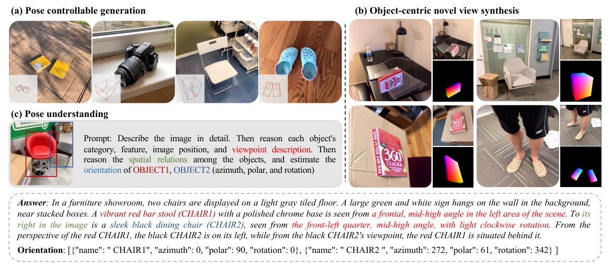
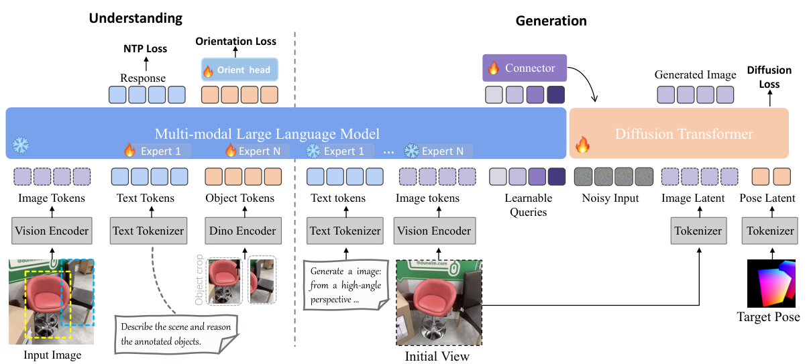

# Object-Uni: A Unified Model for Object-Centric Spatial Understanding and Controllable Generation

<div align="center">

**From understanding object poses to generating objects at target poses.**

[](https://arxiv.org/abs/2608.22757)
[](https://arxiv.org/pdf/2608.22757)

**Mining Tan<sup>†</sup>, Yinuo Wang<sup>†</sup>, Ziqi Zhou, Weize Quan, Sifei Li, Jingdong Chen, Libin Wang, DanDan Zheng, Weiming Dong<sup>*</sup>**

<sub><sup>†</sup> Equal contribution · <sup>*</sup> Corresponding author</sub>

</div>

## News

- **2026.08** — [Object-Uni](https://arxiv.org/abs/2608.22757) is available on arXiv.
- **2026.09** - Object-Uni accepted by NeurIPS 2026.

## Introduction

Most unified vision-language-generation models can **describe** an object, but precisely **reasoning about and controlling its 3D orientation** remains challenging. Object orientation is continuous and geometric; language-based descriptions alone are often too coarse for accurate object-level manipulation.

**Object-Uni** addresses this gap by treating object pose as a **shared geometric variable** across visual understanding, spatial reasoning, and controllable image generation. Built on the **Ming-Lite-Uni** unified multimodal backbone, Object-Uni connects language-level viewpoint reasoning to continuous orientation estimation and pose-conditioned image synthesis.

<div align="center">
  
  <br />
  <sub>Object-Uni supports spatial understanding, pose-controllable generation, and object-centric novel view synthesis (paper Figure 1).</sub>
</div>

## Method

<div align="center">
  
  <br />
  <sub>Overview of the unified understanding-and-generation framework (paper Figure 2).</sub>
</div>

## Release Roadmap
- [ ] UniSpatial-80K dataset access and preprocessing details
- [ ] Inference code
- [ ] Model checkpoints

## Acknowledgments

Object-Uni builds upon **Ming-Lite-Uni** and benefits from prior work including **Orient Anything**, **Orient Anything V2**, and **SceneDesigner**. **UniSpatial-80K** incorporates data from **OmniNOCS** and **ImageNet3D**, including KITTI, Cityscapes, and Objectron.

We sincerely thank the authors and maintainers of [OmniNOCS](https://github.com/google-deepmind/omninocs), [Objectron](https://github.com/google-research-datasets/Objectron), and [ConsID-Gen](https://github.com/eBay/ConsID-Gen) for their prompt and helpful support with data access and processing.

## Citation

If you find Object-Uni useful for your research, please cite:

```bibtex
@article{tan2026objectuni,
  title   = {Object-Uni: A Unified Model for Object-Centric Spatial Understanding and Controllable Generation},
  author  = {Tan, Mining and Wang, Yinuo and Zhou, Ziqi and Quan, Weize and Li, Sifei and Chen, Jingdong and Zheng, DanDan and Wang, Libin and Dong, Weiming},
  journal = {arXiv preprint arXiv:2608.22757},
  year    = {2026}
}
```
